<div align="center">

# 🦀 RustyCord

**Неофициальный клиент Discord на Rust + Tauri + Svelte 5 — построенный на реверс-инжиниринге публичного API**

[](https://github.com/VinylRUS/Rustycord/actions/workflows/ci.yml)
[](https://github.com/VinylRUS/Rustycord/actions/workflows/dev-build.yml)
[](https://github.com/VinylRUS/Rustycord/releases)
[](LICENSE)

`Gateway WebSocket` · `REST v10` · `Snowflake ID` · `Rate Limits` · `Voice UDP + xsalsa20poly1305`

[Установка](#-быстрый-старт) · [Автосборка CI/CD](#-автосборка-через-github-actions) · [Реверс-разбор](#-реверс-инжиниринг-discord) · [Скриншоты](#-скриншоты) · [Roadmap](#-roadmap)

</div>

---

## 📜 О проекте

RustyCord — экспериментальный настольный клиент Discord, который доказывает простую мысль: **для клиента не нужен Electron и 200 мегабайт**. Весь протокол Discord, который официальный клиент держит в секрете за обфусцированным JavaScript-кодом, на самом деле прекрасно документирован сообществом за 10 лет реверс-инжиниринга — и его можно переизобрести на Rust в ~10 МБ бинарника.

Клиент работает в двух режимах:

| Режим | Что делает | Нужен вход? |
|---|---|---|
| **Tauri (боевой)** | Подключается к настоящему `wss://gateway.discord.gg` от **вашего аккаунта** (как официальный клиент): серверы, каналы, сообщения, войс, модерация | Да — QR-код / email+пароль / токен |
| **Демо** | Полная симуляция Gateway на TypeScript: события, статусы, typing, войс — всё как настоящее | Нет |

> ⚖️ **Честно о границах.** Начиная с v0.3.0 RustyCord — это **клиент на пользовательском токене** (как Vesktop/Vencord): вход по QR через официальный remote-auth протокол или email+пароль (+2FA). Это серая зона ToS Discord: пользоваться можно, но это на ваш риск. Не автоматизируйте и не спамьте от имени аккаунта — за это банят быстро. С v0.2.0 сохранился и бот-режим (токен бота вставляется на табе «Токен»).

---

## 🔬 Реверс-инжиниринг Discord

Главная ценность проекта — не интерфейс, а **разбор протоколов**, закодированный в `src-tauri/src/`. Ниже — конспект того, что вскрыто и переизобретено.

### 1. Общая архитектура

Discord — это event-driven система из четырёх транспортных каналов. Официальный клиент держит их все одновременно:

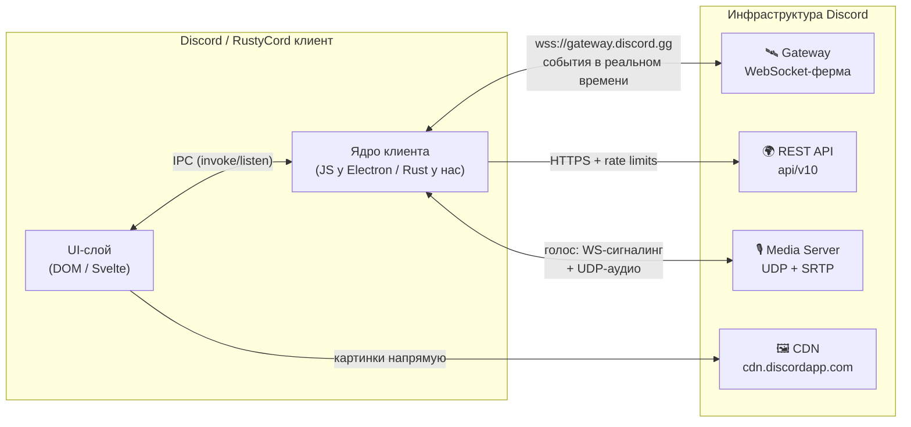

Ключевой реверс-вывод: **сообщения приходят по WebSocket (push), а отправляются по REST (pull-интерфейс)**. Хочешь что-то изменить — POST/ PATCH; хочешь узнать об изменениях — слушай `DISPATCH`. Событие о твоём собственном сообщении тоже приедет по WS — поэтому клиент должен уметь дедуплицировать (мы делаем это в `app.svelte.ts → appendMessage`).

### 2. Gateway WebSocket — событийное сердце

Единственное соединение `wss://gateway.discord.gg/?v=10&encoding=json` несёт всё: сообщения, статусы, typing, войс-сигналинг. Протокол — 15 опкодов:

| Op | Название | Направление | Смысл |
|----|----------|-------------|-------|
| 0 | `DISPATCH` | сервер → мы | Событие: `MESSAGE_CREATE`, `PRESENCE_UPDATE`, … |
| 1 | `HEARTBEAT` | оба | «Я жив». Пульс с последним `seq` |
| 2 | `IDENTIFY` | мы → сервер | Авторизация: токен + **intents** |
| 3 | `PRESENCE` | мы → сервер | Смена собственного статуса |
| 4 | `VOICE_STATE_UPDATE` | оба | Войти/выйти из войс-канала, mute/deafen |
| 6 | `RESUME` | мы → сервер | Восстановить сессию после обрыва |
| 7 | `RECONNECT` | сервер → мы | «Переподключись, пожалуйста» |
| 8 | `REQUEST_GUILD_MEMBERS` | мы → сервер | Дай список участников (придёт чанками) |
| 9 | `INVALID_SESSION` | сервер → мы | Сессия мертва (`d: true` = можно resume) |
| 10 | `HELLO` | сервер → нам | Интервал пульса (`heartbeat_interval`) |
| 11 | `HEARTBEAT_ACK` | сервер → нам | Подтверждение пульса |
| 12–14 | ларп/пейлоады | редко | Ping/voice ping — не нужны обычным клиентам |

Жизненный цикл соединения — конечный автомат (реализован в [`gateway/client.rs`](src-tauri/src/gateway/client.rs)):

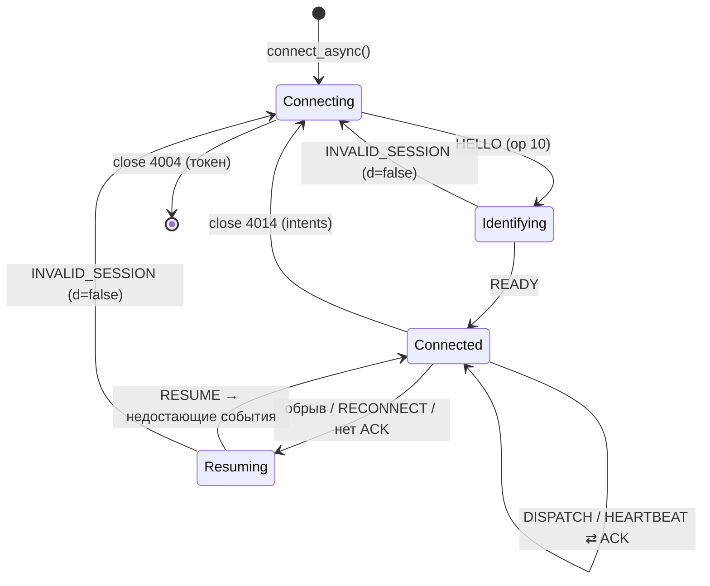

Три тонкости, которые узнаёшь только при реверсе:

1. **Heartbeat-интервал диктует сервер** в `HELLO` (обычно ~41 250 мс). Если два пульса подряд не получают `HEARTBEAT_ACK` — соединение «зомби», надо переподключаться. Мы отслеживаем флаг `acked`.
2. **RESUME спасает от потери событий**: `session_id` + последний `seq` + `resume_gateway_url` (отдельный URL из `READY`!) — и сервер досылает всё, что случилось за простой.
3. **Intents — это подписка на события**. Битовая маска в `IDENTIFY`. Три «привилегированных» бита (`GUILD_MEMBERS`, `GUILD_PRESENCES`, `MESSAGE_CONTENT`) надо включать руками в Developer Portal. Наш клиент при close-коде 4014 **деградирует изящно**: перезапускается без привилегированных интентов и показывает предупреждение, вместо того чтобы упасть. (С v0.3.0 клиент работает от юзер-аккаунта, которому эти биты доступны без аппрува — маска 0x1FFFF.)

Полная последовательность подключения:

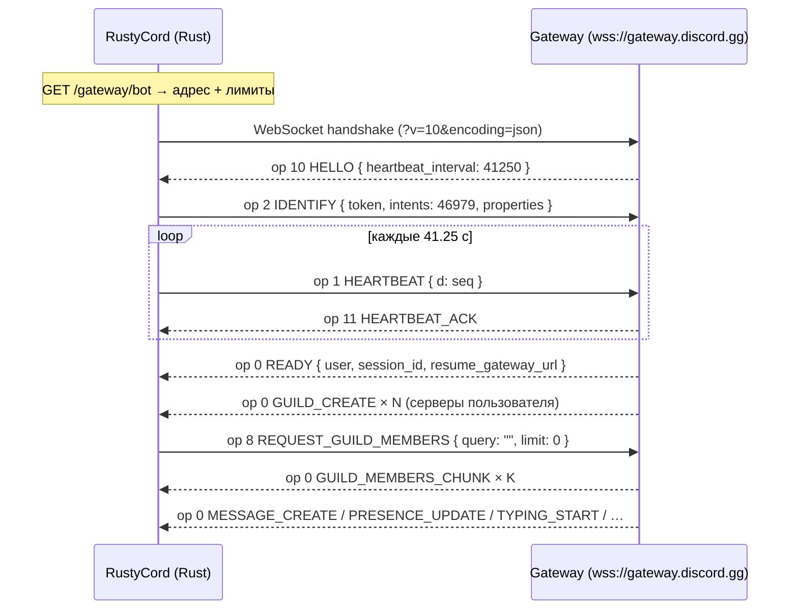

### 3. Snowflake — время, спрятанное в ID

Каждый ID в Discord — 64-битное число, в котором зашит момент создания объекта. Поэтому API **не шлёт поле `timestamp`** в сообщениях: клиент сам декодирует его из ID. Именно так работает `formatStamp()` в нашем фронтенде.

| Биты | Поле | Что означает |
|------|------|--------------|
| 63–22 (42 бита) | `timestamp` | Миллисекунды с **эпохи Discord** = `2015-01-01T00:00:00Z` (1420070400000) |
| 21–17 (5 бит) | `worker_id` | Номер воркера, сгенерировавшего ID |
| 16–12 (5 бит) | `process_id` | Номер процесса |
| 11–0 (12 бит) | `increment` | Счётчик внутри процесса (за миллисекунду) |

```rust
// src-tauri/src/snowflake.rs — вся магия в одной строке
let timestamp_ms = ((snowflake >> 22) as i64) + 1_420_070_400_000;
let worker_id    = (snowflake >> 17) & 0x1f;
let process_id   = (snowflake >> 12) & 0x1f;
let increment    = snowflake & 0xfff;
```

В приложении есть **инспектор снежинок** (шестерёнка → «Инспектор Snowflake»): вставь любой ID — увидишь дату создания, воркера, процесс и инкремент. Парсер работает дважды: на Rust (боевой режим) и на BigInt (демо).

### 4. REST API и Rate Limits

Discord — один из немногих API, где лимиты **самоописываемые**: каждый ответ несёт заголовки, по которым клиент может заранее притормозить, не дожидаясь 429.

| Заголовок | Смысл |
|-----------|-------|
| `X-RateLimit-Bucket` | ID бакета (лимиты вешаются на **маршрут**, не на URL) |
| `X-RateLimit-Remaining` | Сколько запросов осталось в окне |
| `X-RateLimit-Reset-After` | Сколько секунд до сброса окна |
| `X-RateLimit-Global` | `true` — глобальный лимит (50 req/s на бота), пауза всему |

Наш клиент ([`rest/client.rs`](src-tauri/src/rest/client.rs)) строит карту `маршрут → бакет → {remaining, reset_at}` и **спит до сброса до** отправки запроса:

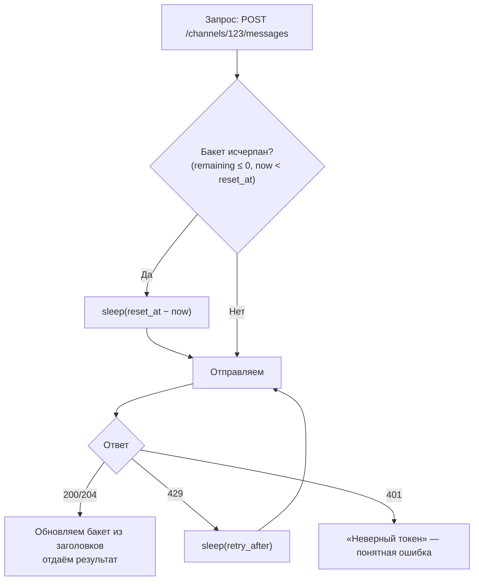

Реверс-нюанс: в ключе маршрута «мажорные» ID (первый после `channels/` / `guilds/`) сохраняются, а все остальные снежинки схлопываются в `{id}` — лимит один на все сообщения внутри канала.

### 5. Клиент изнутри: Electron vs Tauri

Официальный Discord — это Chromium-браузер с бандлом JS, общающийся с нативными модулями через IPC. RustyCord повторяет **архитектуру** (веб-UI + нативное ядро + IPC), но меняет движок:

| | Discord (Electron) | RustyCord (Tauri 2) |
|---|---|---|
| Движок UI | Свой Chromium + Node.js | Системный WebView (WebKitGTK / WebView2 / WKWebView) |
| Ядро протокола | Обфусцированный JavaScript | Читаемый **Rust** (tokio + tokio-tungstenite) |
| Размер бинаря | ~200 МБ | **~10 МБ** |
| Память в простое | ~400–600 МБ | ~80–150 МБ |
| IPC | `ipcMain/ipcRenderer` (JSON) | `invoke()/listen()` (JSON, zero-copy ближе) |
| Локальный кэш | IndexedDB (LevelDB) | `RwLock<HashMap>` в памяти |
| Heartbeat, resume, rate limits | JS-таймеры | Rust-таски tokio (не задушит GC-пауза) |

IPC-контракт у нас один и тот же в обоих мирах — `src/lib/ipc.ts` — а за ним скрывается либо Tauri-команда, либо демо-мок. Фронтенд вообще не знает, какой бэкенд под ним живёт.

### 6. Голосовой протокол — самое красивое

Голос — единственная часть Discord, где WebSocket не главный. Это **трёхсторонний танец**: главный Gateway (сигналинг) → голосовой WebSocket (управление) → чистый UDP (аудио). Полная последовательность (реализована в [`voice/ws.rs`](src-tauri/src/voice/ws.rs)):

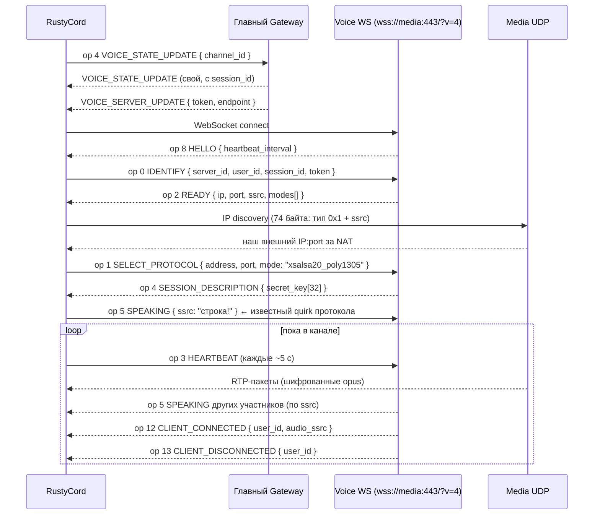

Что здесь реверс-жемчужин:

- **IP discovery** — домашний NAT-обход: клиент шлёт 74-байтный пакет `[0x1][len=70][ssrc][нули]`, а сервер возвращает его же снаружи — с реальным IP:port. STUN не нужен.
- **Шифрование** — NaCl `crypto_secretbox` (XSalsa20 + Poly1305). Нонс — это **сам 12-байтный RTP-заголовок, дополненный нулями до 24 байт**: заголовок ходит открытым текстом и одновременно служит ключом шифрования тела. Раскладка на проводе: `[заголовок 12 Б][MAC 16 Б][opus]`. Реализация — [`voice/crypto.rs`](src-tauri/src/voice/crypto.rs), с юнит-тестом на roundtrip.
- **ssrc то число, то строка** — op 2 присылает число, а op 5 ожидает строку. Классика живого протокола, о которой знают только те, кто его трогал руками.
- **Кто говорит** — ssrc→user маппинг строится из op 12 `CLIENT_CONNECTED` (`audio_ssrc` + `user_id`), а индикация речи приходит в op 5. По ним мы рисуем зелёные кольца вокруг аватарок.

В v0.2 реализован весь сигналинг **и полный аудиодуплекс**:

- **Приём**: расшифрованные opus-кадры декодируются (libopus), раскладываются по SSRC-дорожкам jitter-буфера (переупорядочивание, дедупликация, тишина вместо коротких потерь, ресинк вместо длинных), микшируются и выводятся через cpal — WASAPI / CoreAudio / ALSA. Устройства с частотой ≠ 48 кГц подключаются через линейный ресемплер.
- **Передача**: микрофон → моно 48 кГц → opus (Voip, 20 мс) → RTP с seq/timestamp/marker → xsalsa20poly1305 → UDP. Энергетический VAD с гистерезисом ~300 мс шлёт op 5 SPEAKING только на переходах — как voice activity официального клиента.
- **Мьют/деафиен** едут тем же op 4; ядро слушает эхо VOICE_STATE_UPDATE и останавливает/возобновляет звук на лету, без переподключения сессии.

Сборка `--no-default-features` даёт headless-вариант: сигналинг и криптография работают, аудиоустройства не открываются.

---

## 🛠 Наша реализация

### Стек

| Слой | Технологии |
|---|---|
| Нативное ядро | Rust 1.77+, tokio, tokio-tungstenite (rustls), reqwest, xsalsa20poly1305, audiopus (libopus), cpal |
| Оболочка | Tauri 2 (системный WebView, capabilities-модель безопасности) |
| UI | Svelte 5 (runes: `$state` / `$derived` / `$effect`), TypeScript, Vite 6 |
| Стили | Ручной CSS с дизайн-токенами Discord (`#313338`, `#5865F2`, …) |

### Архитектура процесса

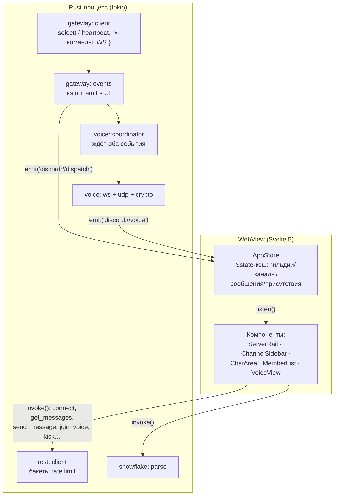

### Структура репозитория

```
rustycord/
├── src/                          # Svelte 5 фронтенд
│   ├── lib/
│   │   ├── ipc.ts                #   контракт UI↔ядро (Tauri / мок)
│   │   ├── mock.ts               #   демо-режим: симуляция Gateway на TS
│   │   ├── stores/app.svelte.ts  #   центральное состояние на рунах
│   │   ├── markdown.ts           #   Discord-подмножество markdown (XSS-safe)
│   │   ├── permissions.ts        #   битовая маска прав (41 флаг)
│   │   ├── time.ts               #   snowflake → «Сегодня в 14:32»
│   │   └── components/           #   15 UI-компонентов
│   └── app.css                   #   дизайн-токены Discord
├── src-tauri/
│   ├── src/
│   │   ├── gateway/              #   опкоды, heartbeat, RESUME, chunking
│   │   ├── rest/                 #   модели v10 + rate-limit-клиент
│   │   ├── voice/                #   сигналинг v4, UDP/RTP, crypto, codec (opus),
│   │   │                         #   jitter-микшер, sender (микрофон), devices (cpal)
│   │   ├── snowflake.rs          #   декодер ID
│   │   ├── state.rs              #   кэш + каналы задач
│   │   └── commands.rs           #   16 Tauri-команд
│   ├── icons/                    #   PNG + ICO + ICNS (все платформы)
│   └── tauri.conf.json
├── .github/workflows/            #   ci · dev-build · release
├── CHANGELOG.md                  #   история версий (Keep a Changelog)
└── docs/screenshots/             #   живые скриншоты
```

---

## 📸 Скриншоты

| Логин | Чат с ролями и реакциями |
|---|---|
| 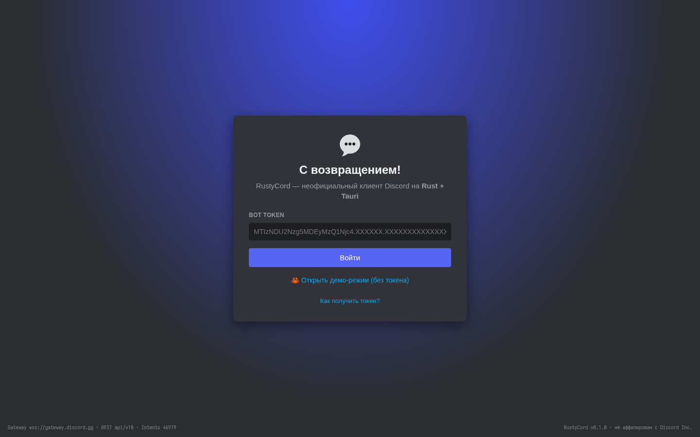 | 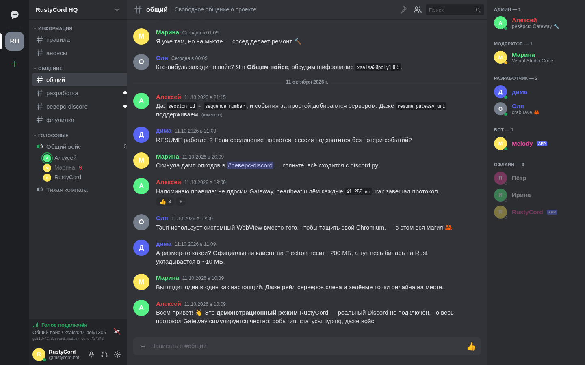 |

| Реверс-канал с код-блоками | Голосовой канал |
|---|---|
| 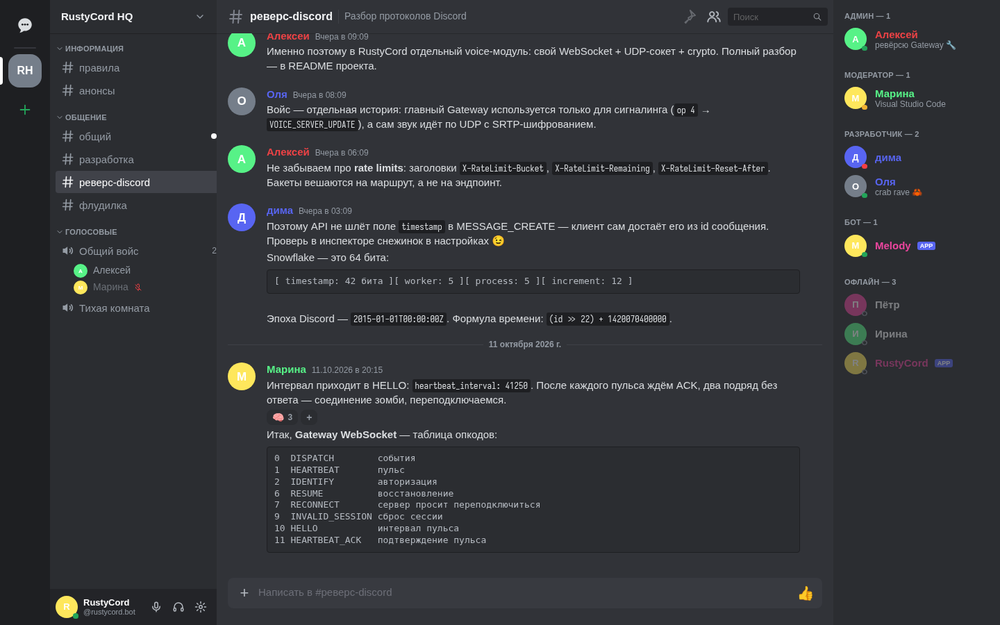 | 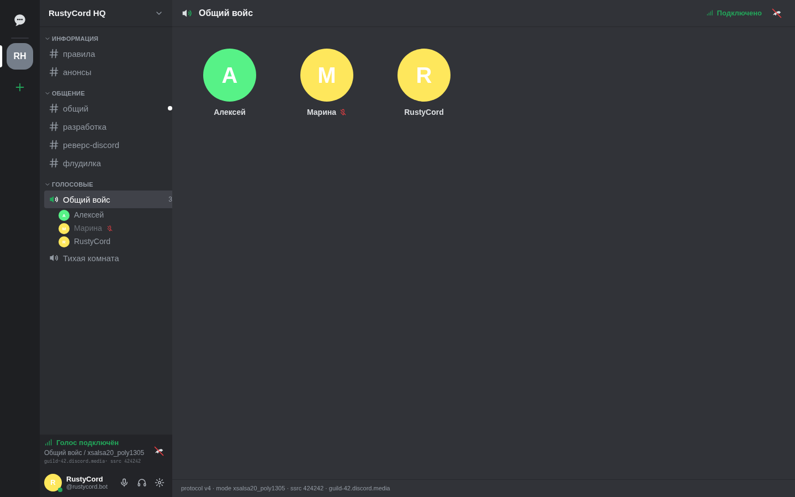 |

| Личные сообщения | Инспектор Snowflake |
|---|---|
| 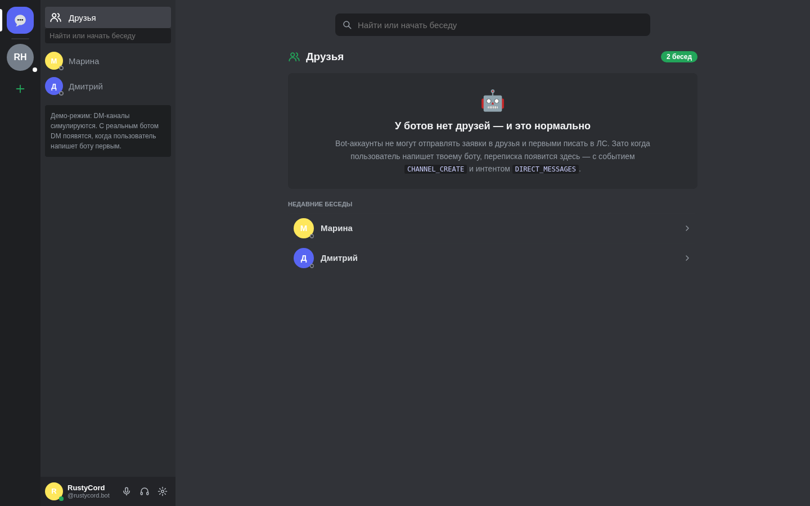 | 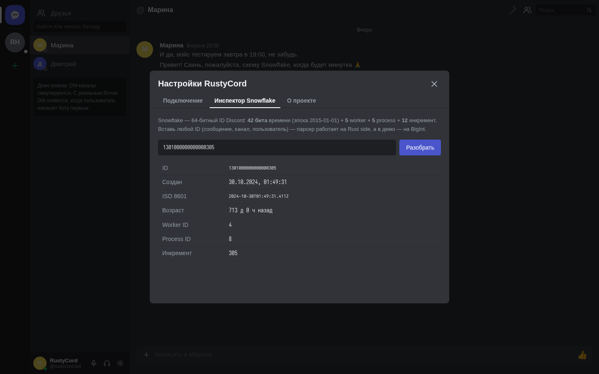 |

Все скриншоты сняты в демо-режиме (`npm run dev` → «Открыть демо-режим») — тот же UI, что и в бою.

---

## 🚀 Быстрый старт

### Вариант А. Готовые сборки (без Rust на машине)

Скачай установщик для своей ОС со страницы [**Releases**](https://github.com/VinylRUS/Rustycord/releases) —
свежий тег собирается автоматически на трёх платформах (см. [CI/CD](#-автосборка-через-github-actions)):

| Платформа | Файл |
|---|---|
| **Windows 10/11** | `RustyCord_0.1.0_x64-setup.exe` (NSIS) или `.msi` |
| **macOS** (Intel + Apple Silicon) | `RustyCord_0.1.0_universal.dmg` |
| **Linux** | `.AppImage`, `.deb`, `.rpm` |

> Dev-сборки последнего main — на вкладке Actions → [Dev Build](https://github.com/VinylRUS/Rustycord/actions/workflows/dev-build.yml) → артефакты запуска.

### Вариант Б. Сборка из исходников

#### Шаг 0. Зависимости

- [Node.js](https://nodejs.org) ≥ 20 и npm
- [Rust](https://rustup.rs) ≥ 1.77 (stable)
- Системные библиотеки Tauri:
  - **Ubuntu/Debian**: `sudo apt install libwebkit2gtk-4.1-dev build-essential curl wget file libxdo-dev libssl-dev libayatana-appindicator3-dev librsvg2-dev libasound2-dev libopus-dev cmake`
  - **macOS**: Xcode Command Line Tools
  - **Windows**: [WebView2](https://developer.microsoft.com/microsoft-edge/webview2/) (уже есть в Win 11) + [MSVC Build Tools](https://visualstudio.microsoft.com/visual-cpp-build-tools/)

#### Шаг 1. Вход в аккаунт (как в оригинале)

Ничего создавать не нужно — с v0.3.0 вход выполняется от **вашего аккаунта**:

- **QR-код** (рекомендуется): открой приложение Discord на телефоне → **Настройки → Устройства → Сканировать QR-код** — и вы в клиенте. Протокол remote-auth **v2** (RSA-OAEP-SHA256, эхо-nonce, обмен ticket → токен через `POST /users/@me/remote-auth/login`, heartbeat по интервалу из hello) реализован на Rust и проверен против живого шлюза; fingerprint сверяется с SHA-256 вашего ключа (защита от подмены), токен расшифровывается только на вашем устройстве.
- **Email + пароль**: как на discord.com/login; при включённой 2FA запросит код аутентификатора (TOTP). Если Discord попросит капчу (новый IP) — используй QR, он капчи не требует.
- **Токен сессии**: вставка токена вручную (например, для отладки; поддерживает и бот-токены).

Вход по QR не создаёт новую «сессию приложения» в списке устройств — серверы видят обычный веб-клиент (совпадающие X-Super-Properties, браузерный User-Agent, актуальный client_build_number тянется с discord.com автоматически).

#### Шаг 2. Собери и запусти

```bash
git clone https://github.com/VinylRUS/Rustycord.git && cd Rustycord   # или распакуй архив
npm install                        # фронтенд-зависимости
npm run tauri dev                  # первый запуск скачает crate'ы (~2-3 мин) и откроет окно
```

Вставь токен → «Войти». Через секунду увидишь свой сервер, каналы и сообщения в живом режиме.

**Демо без входа**: `npm run dev` → открой `http://localhost:1420` → кнопка «Открыть демо-режим». Или в собранном приложении — если запустить UI без Rust-ядра.

#### Шаг 3. Продакшен-сборка

```bash
npm run tauri build                # бинарь + инсталлер в src-tauri/target/release/bundle/
```

---

## 🏭 Автосборка через GitHub Actions

Репозиторий готов к «пуш-и-забудь»: три workflow закрывают весь цикл — от проверки кода до готовых установщиков.

| Workflow | Триггер | Что делает |
|---|---|---|
| [`ci.yml`](.github/workflows/ci.yml) | push / PR | `svelte-check` + production-сборка фронтенда, `cargo fmt --check`, `cargo clippy -D warnings` и `cargo test` на Linux/macOS/Windows |
| [`dev-build.yml`](.github/workflows/dev-build.yml) | push в `main` | Собирает установщики всех трёх платформ и выкладывает как артефакты запуска (без релиза) |
| [`release.yml`](.github/workflows/release.yml) | тег `v*` | Проверяет консистентность версий → собирает → создаёт **черновик GitHub Release** со всеми файлами |

### Как выпустить релиз

```bash
# 1. Обнови version сразу в трёх местах:
#    package.json · src-tauri/tauri.conf.json · src-tauri/Cargo.toml
# 2. Опиши изменения в CHANGELOG.md
# 3. Тегни и запушь:
git tag v0.2.0
git push origin v0.2.0
# → Actions соберёт всё и создаст draft-релиз — останется нажать Publish
```

Джоба `check-version` не даст выпустить релиз, если тег и версии в манифестах расходятся — классическая ошибка «забыл бампнуть» исключена на уровне CI.

### Конвейер сборки

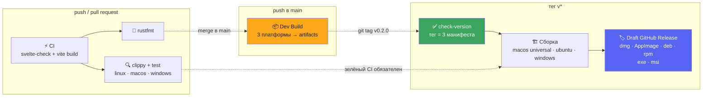

Матрица сборки (все флаги репозитория — Rust cache через `swatinem/rust-cache`, Node 22):

- **macOS-latest** — один универсальный `.dmg` (Apple Silicon + Intel) через `--target universal-apple-darwin`
- **ubuntu-latest** — `.deb` + `.rpm` + `.AppImage` (webkit2gtk-4.1 из apt)
- **windows-latest** — NSIS `-setup.exe` + `.msi` (WebView2 подхватывается автоматически)

<details>
<summary><b>Хочу автообновления приложения</b></summary>

Tauri 2 умеет подписанные дельта-обновления, но для них нужны ключи. Включается тремя шагами:

1. Сгенерируй пару ключей: `npx @tauri-apps/cli signer generate -w ~/.tauri/rustycord.key`
2. Добавь секреты репозитория `TAURI_SIGNING_PRIVATE_KEY` и `TAURI_SIGNING_PRIVATE_KEY_PASSWORD`
3. В `src-tauri/tauri.conf.json` включи `"bundle": { "createUpdaterArtifacts": true }` и раскомментируй блок `env` в `release.yml`

Без этого приложение просто «тупое» — обновляться будет через скачивание нового установщика со страницы Releases, как у большинства десктоп-приложений.
</details>

---

## ✨ Возможности

| Функция | Статус |
|---|---|
| **Авторизация как в оригинале: QR (remote-auth v2: эхо-nonce + ticket → токен)** | ✅ v0.3.1 |
| **Авторизация email+пароль + 2FA (TOTP)** | ✅ v0.3.0 |
| **Пользовательская сессия: X-Super-Properties, браузерный UA, автосборка build number** | ✅ v0.3.0 |
| Подключение к реальному Gateway (IDENTIFY, heartbeat, RESUME) | ✅ |
| Серверы, категории, текстовые каналы | ✅ |
| Real-time сообщения: приём/отправка/редактирование/удаление | ✅ |
| Реакции (unicode + кастомные эмодзи с CDN) | ✅ |
| Typing-индикаторы (TYPING_START + REST trigger) | ✅ |
| Discord-markdown: **жирный**, `код`, блоки, спойлеры, упоминания | ✅ |
| Статусы участников (online/idle/dnd/offline) + кастомные | ✅ |
| Список участников по хойст-ролям с цветами | ✅ |
| Личные сообщения (DM из READY + REST) | ✅ v0.3.0 (юзер) |
| Роли, профиль-карточка, расчёт permission-битов (41 флаг) | ✅ |
| **Управление сервером: имя, каналы (CRUD), роли (цвет/права), участники (ник/роли/кик/бан), бан-лист, инвайты** | ✅ v0.3.0 |
| **Плагины (Vencord-style): JS-файлы, события, REST-мост, CSS-инъекции** | ✅ v0.3.0 |
| Голос: вход/выход, mute/deafen, участники, «кто говорит» | ✅ |
| Голос: полный сигналинг v4 (WS + UDP discovery + xsalsa20poly1305) | ✅ |
| **Аудиодвижок: приём opus → jitter-буфер → микшер → динамики** | ✅ v0.2.0 |
| **Аудиодвижок: микрофон → opus → RTP → UDP + VAD** | ✅ v0.2.0 |
| Инспектор Snowflake (дата создания любого ID) | ✅ |
| Консоль протокола: сырые JSON-кадры прямо в Gateway | ✅ |
| Демо-режим без входа (симуляция Gateway + плагинов) | ✅ |
| Вложения файлов, эмбеды | 🚧 roadmap |
| Поиск по сообщениям | 🚧 roadmap |
| Трансляция экрана (mediasoup-транспорт) | 🚧 roadmap |

---

## 🧩 Плагины (v0.3.0)

Система в духе Vencord: плагин — обычный JS-файл-объект, который исполняется в том же WebView, что и интерфейс. Сетевые запросы идут через Rust-слой с общими rate limits и заголовками сессии. Управление: **Настройки → Плагины** (установка из кода, вкл/выкл, просмотр кода, удаление). Примеры лежат в [`plugins/`](plugins/) репозитория.

```js
({
  name: 'Мой плагин',
  version: '1.0.0',
  author: 'ты',
  description: 'Что делает',
  start(api) {
    // события: message:create / message:update / message:delete /
    //          message:send (хук: вернуть string|false) / dispatch / ready
    api.on('message:create', (m) => console.log(m.author.username, m.content));

    // REST-прокси (те же заголовки и rate limits, что у клиента)
    api.rest('GET', '/users/@me').then(console.log);

    // CSS-инъекция (снимается при выключении плагина)
    api.addCss('.message { letter-spacing: 0.3px; }');

    // поведенческие флаги: 'typing' — не отправлять «печатает…»
    api.suppress('typing', true);

    // localStorage с префиксом плагина + тосты
    api.storage.set('counter', 1);
    api.toast('Плагин запущен!');
  },
  stop(api) {}
});
```

Хранение — `plugins/*.js` в каталоге данных приложения (`%APPDATA%/com.rustycord.app` · `~/Library/Application Support` · `~/.local/share`), плюс `plugins.json` с флагами включения и манифестами. В демо-режиме плагины работают в памяти браузера.

<details>
<summary>📋 Справочник API плагинов</summary>

| Метод | Описание |
|---|---|
| `api.on(event, fn)` | подписка на события клиента (авто-отписка при stop) |
| `api.rest(method, path, body?)` | REST-запрос к api/v10 (rate limits на месте) |
| `api.addCss(css)` | инъекция `<style>` с авто-чисткой |
| `api.suppress('typing', bool)` | подавить отправку typing-индикатора |
| `api.storage.get/set` | изолированный localStorage плагина |
| `api.toast(text)` | тост-уведомление |
| `api.me()` | текущий пользователь |

Событие `message:send` — хук **до** отправки: верните `string` чтобы заменить текст, `false` чтобы отменить. Событие `dispatch` доставляет сырые кадры Gateway `{t, d}` — как Vencord прокидывает flux-события.

</details>

---

## ❓ FAQ

- **Почему нет вкладки «Друзья»?** Список отношений (relationships) из READY пока не рендерится отдельным экраном — DM-каналы работают. В планах.
- **Кик/бан/роли возвращают 403?** Не хватает прав или ваша роль ниже цели в иерархии — так же, как у всех.
- **Discord просит капчу при входе по email?** Это антифрод на новый IP/логин. Используй QR-код — он капчу не требует.
- **Токен слетел после смены пароля?** Discord сбрасывает сессии — войди заново через QR.
- **Это законно?** Клиенты на user-токене (Vencord, Vesktop, Ripcord) живут годами; ToS это нарушает формально, но баны за обычное использование — редкость. Автоспам/скрипты от имени аккаунта = быстрый бан без разбана.
- **Безопасно ли вставлять токен?** Токен хранится только локально (localStorage) и уходит только на discord.com. Никогда не вставляйте его в чужие программы.

---

## 🧭 Roadmap

- [x] **Аудио-движок** (v0.2.0): cpal + libopus, полный дуплекс, jitter-буфер, энергетический VAD, ресемплер под устройства
- [x] **Пользовательская авторизация + управление сервером + плагины** (v0.3.0)
- [ ] **Трансляция экрана**: захват (PipeWire/XDG Desktop Portal, DXGI, ScreenCaptureKit) → VP8/H264 → тот же voice-транспорт
- [ ] Вкладка «Друзья»: relationships из READY, заявки, добавить в друзья
- [ ] Адаптивная глубина jitter-буфера (сейчас фиксированный пре-ролл 40 мс)
- [ ] Вложения файлов (drag&drop → multipart POST)
- [ ] Рендер эмбедов и web-превью ссылок
- [ ] Поиск по истории (REST `/channels/{id}/messages/search` для серверов с бустом… или локальный)
- [ ] Сжатие трафика `encoding=etf` (MessagePack-альтернатива JSON)
- [ ] Мобильная сборка (Tauri 2 умеет iOS/Android)

---

## 🩺 Устранение неполадок

| Симптом | Причина и решение |
|---|---|
| `cargo` не находится | Установи rustup.rs, перезапусти терминал |
| Сборка падает на `webkit2gtk` | Пакеты из Шага 0 не установлены (Linux) |
| Мгновенно «Токен отклонён (4004)» | Токен скопирован с пробелом или сброшен — сделай Reset Token |
| Бесконечное «Подключаемся…» | Проверь доступ к discord.com (VPN/файрвол) |
| Оранжевый баннер не исчезает | Смотри логи: `RUST_LOG=debug npm run tauri dev` |

---

## ⚖️ Дисклеймер

RustyCord — учебный проект для изучения архитектуры мессенджеров. Не аффилирован с Discord Inc. Discord — товарный знак Discord Inc. Клиент работает на **пользовательском токене** (как Vencord/Vesktop) — это формально нарушает ToS Discord; авторы проекта не несут ответственности за блокировку аккаунта. Токен хранится исключительно локально (`localStorage`) и передаётся только на `discord.com`. Не используйте клиент для автоматизации и спама от имени аккаунта.

## 📄 Лицензия

MIT — см. [LICENSE](LICENSE). Крабов при сборке не обижать. 🦀

История версий — в [CHANGELOG.md](CHANGELOG.md).


